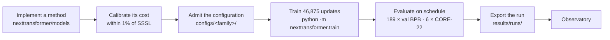

<div align="center">

# NextTransformer

**Toward the next generation of Transformers, compared under one fixed training budget.**

[Protocol](PROTOCOL.md) · [Status](PLAN.md) · [Results](results/README.md) · [Models](nexttransformer/models/README.md) · [Arena](ARENA.md) · [Contributing](CONTRIBUTING.md) · [Observatory](website/README.md)


</div>

NextTransformer asks one question: **when the training budget is fixed, how should a language model spend its computation?**
Recurrent depth, sparse attention, linear attention, and residual-stream variants all train on the same data stream, for the
same 49.152B tokens, at the same theoretical training FLOPs per token, and are evaluated at the same checkpoints.

## Highlights

- **33 registered methods in seven families**, with a shared backbone, data, optimizer schedule, and evaluation contract.
- **Audited compute.** Charge forward, backward, auxiliary, recomputation, and optimizer work; require ≤1% preflight
  error against SSSL and ≤2% final cumulative error.
- **File-backed results.** Reviewed run records in [`results/`](results/README.md) supply the observatory.
- **Explicit reproducibility checks.** Pin inputs and source fingerprints; resume guarantees depend on the tested
  runtime and layout. See the [protocol](PROTOCOL.md#validation-pilots-and-resume) and outstanding checks in [PLAN.md](PLAN.md).
- **Automated research.** LLMs can submit architectures under the same protocol, with research disclosures ([arena rules](ARENA.md)).

## How a comparison works



| Controlled | Value |
|---|---|
| Data | ClimbMix at a pinned revision, one tokenizer and byte table, one global sample stream |
| Budget | 49.152B input tokens · 1,048,576 tokens per update · 46,875 updates · seed 42 |
| Compute | 4.67239832544785 GFLOPs per input token (SSSL anchor) |
| Evaluation | Validation BPB every 250 updates (189 events) · full CORE-22 at 8K, 16K, 24K, 32K, 40K, and 46,875 |

Parameters, memory, throughput, and GPU-hours are **outcomes**, not controls. [PROTOCOL.md](PROTOCOL.md) is the full contract.

## Results

Finished formal runs, generated from [`results/`](results/README.md) with `python -m nexttransformer.export_run --summary`.
Validation BPB is the periodic evaluation at update 46,875; CORE is ×100. Δ columns are differences from the full-attention
**Dense Baseline** at the same checkpoint: below zero is better for BPB, above zero for CORE.

| Model | Family | Val BPB ↓ | Δ BPB | CORE ↑ | Δ CORE | Training GFLOPs / token | Hardware |
|---|---|---:|---:|---:|---:|---:|---|
| **[Dense Baseline](results/runs/dense_full.json)** | baseline | 0.6672 | — | 33.10 | — | 4.675 | A800 ×8 |
| [Manifold-Constrained Hyper-Connections · mHC](results/runs/mhc.json) | residual | 0.6617 | -0.0055 | 35.33 | +2.23 | 4.674 | A800 ×8 |
| [Hyper-Connections · HC](results/runs/hc.json) | residual | 0.6644 | -0.0028 | 35.09 | +2.00 | 4.698 | A800 ×8 |
| [Block Attention Residuals · AttnRes](results/runs/attnres.json) | residual | 0.6630 | -0.0042 | 34.00 | +0.90 | 4.680 | A800 ×8 |
| [SSSL](results/runs/sssl.json) | others | 0.6671 | ±0.0000 | 33.78 | +0.69 | 4.775¹ | 8 × A800 80GB |
| [Native Sparse Attention · NSA](results/runs/nsa.json) | sparse | 0.6678 | +0.0006 | 33.78 | +0.69 | 4.639 | H800 ×8 |
| [Hybrid GDN + SWA](results/runs/gdn_hybrid_swa.json) | hybrid | 0.6656 | -0.0015 | 33.66 | +0.57 | 4.647 | 8 x B300 (1 node; device reports NVIDIA B30Z) |
| [Hybrid GDN + MHA](results/runs/gdn_hybrid.json) | hybrid | 0.6647 | -0.0025 | 33.37 | +0.28 | 4.704 | 8 x B300 (1 node; device reports NVIDIA B30Z) |
| [Grouped-Query Attention · GQA](results/runs/gqa.json) | others | 0.6741 | +0.0069 | 32.62 | -0.47 | 4.687 | H800/H200 ×8 |
| [Multi-head Latent Attention · MLA + QK-norm](results/runs/mla_qknorm.json) | others | 0.6759 | +0.0087 | 32.53 | -0.56 | 4.670 | H20 ×32 (4 nodes) |
| [Fixed Recursive](results/runs/fixed_recursive.json) | looped | 0.6784 | +0.0112 | 32.45 | -0.65 | 4.663 | H800 ×8 |
| [LoopFormer-Fixed2](results/runs/loopformer.json) | looped | 0.6792 | +0.0121 | 32.03 | -1.06 | 4.776¹ | 8 × A800 80GB |
| [Multi-Query Attention · MQA](results/runs/mqa.json) | others | 0.6769 | +0.0098 | 31.96 | -1.13 | 4.664 | H800/H200 ×8 |
| [Standard Residual](results/runs/residual_standard.json) | residual | 0.6740 | +0.0068 | 31.95 | -1.14 | 4.674 | A800 ×8 |
| [DeepSeek Sparse Attention · DSA](results/runs/dsa.json) | sparse | 0.6679 | +0.0007 | 31.77 | -1.33 | 4.651 | H800 ×8 |
| [Gated Linear Attention · GLA](results/runs/gla.json) | linear | 0.6690 | +0.0018 | 31.11 | -1.99 | 4.701² | 8 × H200 |
| [Kimi Delta Attention · KDA](results/runs/kda.json) | linear | 0.6671 | ±0.0000 | 31.06 | -2.03 | 4.692 | H20 ×8 |
| [Mixture of Block Attention · MoBA](results/runs/moba.json) | sparse | 0.6740 | +0.0068 | 31.04 | -2.05 | 4.674 | H800 ×8 |
| [SeerAttention-style](results/runs/seer.json) | sparse | 0.6686 | +0.0014 | 30.81 | -2.28 | 4.660 | H800 ×8 |
| [Gated DeltaNet · GDN](results/runs/gdn.json) | linear | 0.6700 | +0.0028 | 30.55 | -2.55 | 4.687 | H20 ×32 (4 nodes) |
| [Mixture-of-Recursions · MoR](results/runs/mor.json) | looped | 0.6838 | +0.0166 | 30.37 | -2.73 | 4.958¹ | 8 × A800 80GB |
| [Universal Transformer · ACT](results/runs/ut_act.json) | looped | 0.6894 | +0.0222 | 30.07 | -3.03 | 4.660 | H800 ×8 |
| [Qwen Sparse Attention · QSA](results/runs/qsa.json) | sparse | 0.6708 | +0.0036 | 29.82 | -3.27 | 4.628 | H800 ×8 |
| [RetNet · Retention](results/runs/retnet.json) | linear | 0.6825 | +0.0153 | 29.36 | -3.73 | 4.630 | H20 ×8 |
| [Circle Loop](results/runs/circle.json) | looped | 0.6912 | +0.0240 | 28.97 | -4.12 | 4.977¹ | 8 × A800 80GB |
| [DeltaNet](results/runs/deltanet.json) | linear | 0.6787 | +0.0115 | 28.34 | -4.76 | 4.685² | 8 × H200 |
| [Gated Slot Attention · GSA + QK-norm](results/runs/gsa_qknorm.json) | linear | 0.6852 | +0.0181 | 28.17 | -4.92 | 4.689 | 8 × H200 |
| [Ouro · LoopLM](results/runs/ouro.json) | looped | 0.7075 | +0.0403 | 27.70 | -5.40 | 4.658 | H800 ×8 |
| [MLA-NoPE + QK-norm](results/runs/mla_nope_qknorm.json) | others | 0.6856 | +0.0184 | 27.65 | -5.44 | 4.686 | H20 ×32 (4 nodes) |
| [Huginn · Recurrent-depth](results/runs/huginn.json) | looped | 0.7036 | +0.0365 | 27.26 | -5.84 | 4.649 | H800 ×8 |
| [DeepLoop](results/runs/deeploop.json) | looped | 0.7172 | +0.0500 | 25.45 | -7.64 | 4.661 | H800 ×8 |
| [ELU+1 · q/k-normalized](results/runs/elu_qknorm.json) | linear | 0.6998 | +0.0326 | 23.04 | -10.05 | 4.652 | H20 ×16 (2 nodes) |

> Single-seed runs on different hardware and rank counts; orderings are observations, not statistical results.
> Unmarked compute comes from the operator-level ledger. ¹ The historical matrix-FLOPs estimate of the first native
> implementations. ² The operator-level ledger with backward replay, frozen with the earlier source these runs trained on.
> Compute values are comparable only under the same mark. H800 records carry the trainer's reported cumulative audit; the
> H20, H200, Dense Baseline and Residual records add a read-only audit of the run directory; the two Hybrid records add
> read-only audits of their supplied run metadata, with pilot and resume acceptance still pending; the first native runs
> rest on owner-verified training logs. Runs in progress and pending methods are tracked in [PLAN.md](PLAN.md).

## Model zoo

| Family | Methods | Code |
|---|---|---|
| Baseline | Dense with full attention (`dense_full`) | [`backbone.py`](nexttransformer/models/backbone.py) |
| Looped | UT-ACT · Fixed Recursive · Huginn · Ouro · DeepLoop; historical native track: MoR · LoopFormer · Circle Loop | [`looped.py`](nexttransformer/models/looped.py) · [`native/`](nexttransformer/models/native) |
| Sparse | DSA · QSA · NSA · SeerAttention-style · MoBA | [`sparse.py`](nexttransformer/models/sparse.py) |
| Linear | DeltaNet · GLA · KDA · RetNet · ELU+1 variants · GDN · KDA-noVE control | [`linear.py`](nexttransformer/models/linear.py) |
| Residual | Standard-residual control · HC · mHC · Block AttnRes | [`residual.py`](nexttransformer/models/residual.py) |
| Hybrid | DeltaNet + MHA (H01) · GDN + MHA (H02) · GDN + SWA-2048 (H03) · KDA + MLA-NoPE (H04) · GDN + QSA (H05) · MoBA + MHA (H06) | [`lm.py`](nexttransformer/models/lm.py) |
| Others | SSSL (historical `dense`, the cost anchor) · registered controls `mla_nope` · `mha_no_ve` | [`backbone.py`](nexttransformer/models/backbone.py) · [`others.py`](nexttransformer/models/others.py) · [`lm.py`](nexttransformer/models/lm.py) |

The [registry](nexttransformer/models/registry.py) contains all six hybrids H01–H06; registration and cost admission
do not imply completed formal training. GDN + MHA and GDN + SWA have published formal runs from the same frozen earlier source
([record 052](docs/records/EXPERIMENTS.md#record-052), [record 053](docs/records/EXPERIMENTS.md#record-053)); the GDN + SWA
run added a B300 cluster patch whose source diff is still pending. Its 2,048-key window equals full causal attention at this
protocol's 2K context.
Four frozen Others results (MQA, GQA, MLA + QK-norm, MLA-NoPE + QK-norm) are published, while their mainline model port
and admission remain pending; the current Others registry contains SSSL and the two controls above. SSSL is listed under
Others because only full-attention Dense is a baseline; it remains the compute anchor of every budget. See [PLAN.md](PLAN.md).

These are adaptations in a shared shell, not reproductions of every paper's full recipe.
The [source notes](docs/methods/SOURCES.md) document the differences.

## Quick start

```bash
uv sync --frozen --extra cpu && source .venv/bin/activate
export NANOCHAT_DTYPE=float32 TORCH_COMPILE_DISABLE=1 CUDA_VISIBLE_DEVICES=
python -m pytest tests/test_models_api.py -q
```

Use the [model API guide](nexttransformer/models/README.md) to build or load a model, the
[configuration guide](docs/guide/CONFIGURATION.md) for data preparation and training/evaluation settings, and the
[results guide](results/README.md) to export a finished run. Launchers are in [`launch/`](launch).

`python -m nexttransformer.train` runs in **research mode** by default: you can change the code or use another
PyTorch build and still train. The trainer prints the configuration's cost against the shared budget, records any
stale or out-of-budget cost evidence, and marks the run as research, which `export_run` will not publish.
Leaderboard runs pass **`--formal`**: the configuration's cost proof must match the source and PyTorch version it was
audited with, and every segment of the run must be formal. The cluster launchers in `launch/` pass `--formal`.

## Repository layout

Architectures and runtime code live in [`nexttransformer/`](nexttransformer), scientific configurations in
[`configs/`](configs), published runs in [`results/`](results/README.md), and review evidence in
[`evidence/`](evidence/README.md). [`nextt_gym/`](nextt_gym/README.md) provides the research environment;
[`website/`](website/README.md) renders the observatory. The [repository guide](docs/guide/REPOSITORY.md)
contains the full layout and earlier-path mapping.

## Contributing

Contributions arrive as pull requests: a new method as a plugin under `nexttransformer/methods/` (code, configuration,
cost proof, model card; see the [plugin guide](docs/guide/PLUGINS.md)) or a finished run (`results/runs/`). A plugin
leaves every shared file and every other method's proof unchanged. Only the maintainer updates `main`. Read
[CONTRIBUTING.md](CONTRIBUTING.md) before opening one.

## Auto-research arena

Give an agent the [task statement](docs/arena/TASK.md) and a checkout. It enters through an admission PR that freezes
the method before formal training, then a result PR, with a [disclosure card](results/arena/README.md) recording the
LLMs, framework, human help, research costs, selection signal, and novelty. Select candidates using training loss
or the dev split; formal validation and CORE are not tuning signals. The optional [Gym](nextt_gym/README.md) provides verified
submissions and metered research runs; Gym results alone do not enter the formal leaderboard.
See [ARENA.md](ARENA.md) for rules, [PLAN.md](PLAN.md) for current completion and acceptance status, and
[Circle Loop](docs/arena/circle-loop.md) for the legacy L3, human-led example.

## Citation

```bibtex
@misc{nexttransformer2026,
  title  = {NextTransformer: Comparing Transformer Architectures under a Fixed Training Budget},
  author = {Su, Yue and NextTransformer contributors},
  year   = {2026},
  url    = {https://github.com/Selen-Suyue/NextTransformer}
}
```

Released under the [MIT license](LICENSE). NextTransformer builds on [nanochat](https://github.com/karpathy/nanochat);
upstream attribution is kept in [docs/upstream](docs/upstream).
