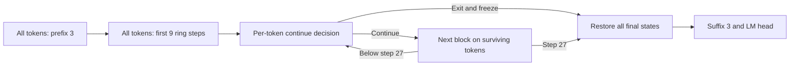

# Circle Sparse: execution, routing, and budget

> Historical record. Paths, module names, and commands are those in use at the time; the 2026-10-24
> reorganization maps them as described in [the repository guide](../guide/REPOSITORY.md).

This is the historical 2026-10-13 native algorithm in [`configs/native/circle.json`](../../configs/native/circle.json). It replaced the older full-candidate ST implementation. Old checkpoints require their original source snapshot (for example `0ea4cb1`); this is a semantic change, not an equivalent acceleration.

## Architecture

| Setting | Value |
|---|---|
| Prefix / shared ring / suffix | 3 / 9 / 3 distinct blocks |
| Minimum / maximum core depth | 9 / 27 block calls |
| Mean target core depth | 17.5 |
| Minimum / maximum / target total depth | 15 / 33 / 23.5 |
| Independent parameters | 927,992,523, including 1,555 halter parameters |
| Width / heads / FFN | 1536 / 12 / 6144 |
| Context / vocabulary | 2048 / 32768 |
| Training | Seed 42; 49.152B tokens; 1,048,576 tokens/update; 46,875 updates |

The native shell retains RoPE, QK normalization, RMSNorm, ReLU², VE, residual/x0, embeddings, smear/backout, and logit softcap. Nine distinct ring blocks share parameters only when execution wraps around. VE/residual coefficients share with their physical block. SSSL windows follow virtual execution position, with a long final suffix layer; original positions survive compaction.

## Forward execution

1. Every token executes three prefix blocks and the first complete nine-block ring traversal.
2. After core steps 9–26, the halter chooses which tokens execute the next block.
3. Gather surviving tokens and compute only their Q/K/V, attention, output projection, and FFN.
4. Exited states freeze with no reentry. Their K/V **do not participate in later ring attention**.
5. Stop at core step 27, restore final states to original positions, then apply exit RMSNorm, three suffix blocks, backout/final RMSNorm, and the single LM head.



A continuing token cannot directly read an exited token's K/V at the next ring step, though earlier information remains in its state. The suffix reopens causal interaction across the full sequence. Training and whole-sequence BPB/CORE are supported; incremental KV-cache decode is not. Rectangular SDPA pads to each batch's maximum surviving length, adding execution cost.

## Halter and LM gradient

At completed core step s (9≤s≤26):

```text
exit_logit = w · RMSNorm(h_after)
           + a · log(eps + RMS(h_after-h_before)/(eps+RMS(h_before)))
           + b[s-9]
q = sigmoid(-exit_logit)
```

w has 1536 entries, a is scalar, b has 18 depth biases; eps=1e-6. The FP32 halter reads only the current token's existing state. Learned routing and evaluation continue deterministically when q≥.5, without future-token ranking, sequence top-k, or batch-dependent thresholds. Initialize w with standard deviation 1/sqrt(width), a=0, and biases from reference conditional-survival normal quantiles; exact initial hard budget is not guaranteed.

For a selected token, F is the next complete block update on the surviving set:

```text
h_next = h + q*(F(h)-h)
dL_LM/dq = (dL_LM/dh_next) · (F(h)-h)
```

q=.8 does not execute .8 of a block. Both train/eval retain this continuous residual weight. Rejected candidates are not computed and receive no direct counterfactual LM benefit gradient. Discrete selection effects are not fully represented; this is a biased gating mechanism, not an unbiased optimal-exit estimator.

## Loss and controller

The reference depth distribution is maximum entropy on 9–27 with mean 17.5: `p(d) proportional to exp(tilt*d)`. Let S_ref[s]=P(D≥s), S_hat be hard survival, D_bar=sum(S_hat), and e=D_bar/17.5−1.

```text
L = L_LM + lambda*e + 0.5*rho*e^2
         + beta*mean((S_hat[10:27]-S_ref[10:27])^2)
rho = 1; beta = 0.1
proxy_next = hard_next + alive_now*learned_decision*(q-stop_gradient(q))
```

Forward uses hard statistics; the local ST proxy sends budget gradients only through learned decisions. Randomly forced decisions receive no budget gradient, though selected residual weights still receive LM gradients. No rejected block is recomputed and no long sigmoid product supplies the budget gradient.

Aggregate all rank/microbatch hard counts once per complete update:

```text
EMA = 0.9*EMA + 0.1*global_error
lambda = clip(lambda + 0.05*EMA, -2, 2)
```

Do not update lambda during random warmup. Negative lambda can recover underused compute. Quadratic loss terms are microbatch-local; controller updates are global, so different splitting can change regularizer gradients. Matching average depth alone does not demonstrate useful content allocation.

## Curriculum, optimizer, and recovery

Updates 0–255 assign random reference depths. Updates 256–1023 linearly increase learned-route probability from 1/768 to one. Select each token's random/learned route at forward start, preventing reentry. Later updates use learned routing; evaluation always uses deterministic learned routing with no controller update.

Curriculum inputs count toward the same budget. Save rank-specific routing RNG, model, optimizer, controller, and complete data cursor/buffer for exact recovery. Halter AdamW base LR is .0006×.5, scaled by sqrt(2), peak approximately .000424264; clip only its gradients to norm 1 after accumulation/DDP. Main optimizer groups retain the native policy. Record global gradient norm before clipping.

## Evidence and limitations

Historical theoretical cost is approximately **4.779 GFLOPs/input token**, using the reference route distribution and rectangular-attention matrix estimate, with forward×3. Actual routing and padding are logged; elementwise/lookup/optimizer/communication are excluded from this historical scheme. It is not the current full-cost proof or a speed guarantee.

Tests cover sparse-vs-dense-mask outputs/gradients, original positions/windows, empty sets/padding, no reentry, shallow/deep routes, LM halter gradients, budget direction, zero-change stability, RNG, and checkpoint resume. The algorithm pilot completed 128 updates and resumed to 129 with small-sample BPB/CORE checks. It used shortened **8/24** warmup/transition to exercise all stages; formal values remain **256/768**.

From step 96, recorded mean core depth was 17.773, cap fraction about 20%, per-step depth range 13.957–19.590, maximum gradient norm 1.853. Full-27-step stress testing passed at per-rank batch 8 on eight A800s, peak allocated/reserved 75.878/77.672 GiB. These are bounded mechanism/memory checks, not proof of 49B convergence, exact per-step budget, or quality gains. See [validation](NATIVE_VALIDATION.md).

Implementation: [`circle.py`](../../nexttransformer/models/native/circle.py), [`halter.py`](../../nexttransformer/models/native/halter.py), [`depth.py`](../../nexttransformer/models/native/depth.py), [`budget.py`](../../nexttransformer/models/native/budget.py), and [`model.py`](../../nexttransformer/models/native/model.py). Launch/preflight commands are in [native experiments](NATIVE_D24.md).
