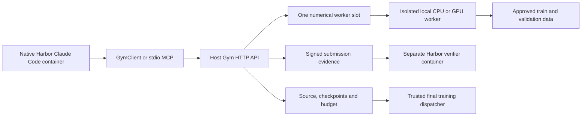

# Gym design

[中文](DESIGN.zh-CN.md) · [Usage and API](README.md#gym-api)

This document defines the architecture, responsibilities and limits of the repository's Gym. The usage document defines commands, API parameters and candidate inputs.
Harbor and the shared NextTransformer scientific code remain unchanged.

## Architecture and responsibilities

Harbor 0.24.0 and task schema 1.4 control containers, native Claude Code, trajectories and artifact collection.
Gym runs on the host and controls experiments, resources, data, retained source and budgets.
Gym adds no Agent subclass, model broker or separate reasoning loop. Agent collaboration does not change the session budget or numerical concurrency.

The Agent has shell tools and internet access inside its container.
Gym supplies historical results, model configurations and approved source references without a repository checkout or Git access.
Historical records distinguish current reference code from the code of a published experiment.
Each session can read only its own private experiments.

## HTTP and MCP

HTTP defines the interface through authenticated JSON calls to `POST /v1/call`.
`describe_space.operation_schemas` defines the operations and input schemas.
HTTP checks input schemas, permissions and budget rules before it executes an operation.
The Python client only handles transport and imports no training code.

The stdio MCP adapter reads these schemas and forwards calls through the same client.
SDK and MCP share credentials, results, errors, jobs and idempotency rules.
MCP adds no scheduler, budget account or HTTP listener. Harbor registers MCP through its native Claude Code integration.
The [usage document](README.md#gym-api) lists the API and candidate formats.

## Trial lifecycle and state

Each trial starts a separate host service with private state and separate Agent and verifier credentials.
The Agent mounts only its credential directory and a directory for signed evidence, both read-only.
The Agent receives no repository, training state, checkpoint root, GPU device, verifier credential or Docker socket.
The independent verifier mounts only its credential and has no network access.

The host listener binds port 0 on the Docker bridge address by default.
The operating system selects a free port, and Gym retains the bound socket.
Gym saves that port in the service state and reuses it after a restart.
A port conflict causes an explicit error. The listener file saves the port, not the bind address.

At Agent exit, a Harbor hook stops research, settles numerical work and signs evidence from the live service.
Harbor collects that evidence and a snapshot of the Agent container's actual processes before verification.
Host state remains after the trial ends. A new trial creates separate state and a new listener.
The launcher is not a persistent service manager for multiple tenants.

## Data and feedback

| Set | Data | Research access |
| --- | --- | --- |
| Train | Ordered ClimbMix prefix before the dev shard (through shard 06540) at full scale | Gym training |
| Dev | `shard_06541.parquet`, the last training shard in sorted order; a formal stream never reaches it | Feedback for algorithm selection |
| Validation | Last shard, `shard_06542.parquet`, matching native defaults | Reserved for the formal run; research never opens it |
| Test | CORE-22 | Reserved for the formal run; new-candidate scores only after freezing and fresh final training |

Operators fix manifests, shard order, tokenizer and execution profiles before research.
The adapter refuses an exhausted training prefix. `dev_path`, `dev_batches` and `dev_bpb` refer to the dev shard.
Every research data view rejects the validation shard.

Shipped profiles use labelled synthetic fixtures, not production ClimbMix data.
Final ranking uses only CORE-22. Training and validation metrics remain diagnostics.
Historical CORE results and public web information remain accessible.
The boundary restricts new-candidate feedback, not prior knowledge of the public benchmark.

## Native candidates and isolation

The `reference_plugin_v1` contract preserves native plugin source, metadata and local Python modules.
Native hooks include `model`, `mixer`, `ffn` and `block`. A `model` hook subclasses `ReferenceLM`.
Gym uses the native loader without an expression language or source translation.

`architecture.json` contains native `ModelConfig` fields and declared plugin options.
Profiles fix protocol values, including width, heads, context, vocabulary and scale.
Explicit candidate values must match those constraints.
Gym rejects optimizer settings, data paths and command overrides as architecture fields.
Upload checks metadata and field types without importing candidate code.
Workers check imports, native semantics, shapes and numerical behavior.

Packages contain at most 1 MiB and 32 text files inside the permitted layout.
Gym rejects traversal, symlinks, duplicate paths, runtime shadowing, binaries, weights and dependency installers.
Each session can retain at most 128 candidates. Changing source or configuration creates a new immutable candidate.

The operator selects the research worker isolation backend. Gym never switches backends automatically.
The default `bwrap` backend uses fresh bubblewrap user, mount, PID and network namespaces.
The `landlock` backend serves hosts that deny mounts. It requires a root controller, so workers run as a separate user.
It combines Landlock path rules with user, network, IPC and UTS namespaces. CPU workers also get a PID namespace and a seccomp filter against new Unix sockets.
The `none` backend disables isolation for trusted candidates. Gym prints a warning when it starts with this backend.
Isolated workers can read only runtime libraries, platform code, approved data and the current job's checkpoint/output.
Isolated workers cannot read controller state or credentials and have no host networking. CPU inspection receives no GPU devices.
Under `bwrap`, CUDA workers receive the selected NVIDIA devices, required control/UVM devices and read-only driver metadata with a private PID procfs.
Under `landlock`, workers can detect path existence, list directories under the import roots and change file metadata.
CUDA workers keep the host PID namespace, can create Unix sockets and can open every NVIDIA device node.

## Resources and concurrency

The supported scope is one local machine and one concurrent numerical job per service state.
That job may use any explicitly configured group of local GPUs; one job does not mean one GPU.
The operator selects the GPU group and per-device microbatch size before starting the service.
Research training uses data parallelism and gradient accumulation with a fixed global update batch.
All sessions in that state share the worker slot, including jobs with uncertain outcomes.
Separate states do not share a machine-wide scheduler lock.
Operators run one research trial at a time to enforce the agreed scope.
Concurrent independent numerical jobs are outside this scope.
An operator executor (below) may run the one job on other machines instead: the Gym's multi-node executor
runs it on a group of machines over ssh, and a cluster plugin can supply its own transport.

The operator controls GPU allocation, memory limits and the CUDA Python environment.
The launcher converts GPU indices to stable UUIDs and saves the execution policy.
The Agent can inspect resources and choose an absolute target update within profile limits.
A single-GPU allocation also accepts explicit `gpu_id` placement; multi-GPU jobs use the entire operator-selected group.
The Agent cannot change the trainer or submit shell commands, environment overrides, data paths or SSH jobs to Gym.
Resource reports distinguish discovered, allocated and available devices, with reasons for unavailable capacity.

A busy GPU leaves work queued with its budget reservation and no numerical charge or CPU fallback.
Cooperative leases are local GPU locks for participating Gym processes under the same host user. The leases do not control unrelated applications.

By default, any compute or graphics process blocks dispatch.
Operator-only `allow_idle_graphics` permits graphics processes only with zero observed utilization, no compute process and sufficient memory.
Lease checks still apply, and unknown process observations block dispatch.
Memory admission bounds and the PyTorch allocator cap do not create a hardware partition.
These controls do not guarantee a limit on arbitrary direct CUDA allocations.
Results record the primary model device, all allocated GPU IDs, runtime versions and per-device peak GPU memory.
Training cost bounds trace the actual microbatch shapes and include gradient reduction/accumulation arithmetic;
optimizer cost is charged once per global update. Diagnostics retain their full-batch cost and memory bounds.

## Operator executors

An operator executor runs the scheduled numerical jobs somewhere other than the controller.
The controller, API, budget, evidence and static audits stay on this machine and are unchanged.
The operator declares the executor in the execution configuration (`executor.py` documents the fields):

- `command` replaces the local worker for every scheduled job: research training, checks and final runs.
  It starts in the state directory as the controller's user and speaks the worker protocol on stdin/stdout.
- `environment` names controller variables (credentials) that only the executor process receives.
- `devices` are the cards one job may use, in order. Gym leases them like local cards and never observes them.
  Their names are what agents see. `gpu_ids` defaults to their ids.
- `runtime` is the remote numerical interpreter's record. The revision binds it instead of a local query.
- `isolation` and `network` state how the remote side confines candidate code. `none` prints the unisolated warning.

Static audits keep the configuration's own `isolation`, so a controller without GPUs still sandboxes them.
Agents and the revision see the configuration without `command` and `environment`.
Resource reports name the backend `operator_executor`.

The worker protocol is the interface. Gym writes the request as one JSON line and answers each event:
an intent with an acknowledgement or a cancellation, a charge (repeating the open intent) with an acknowledgement,
and a `poll` with a cancellation or `{"continue": true}`.
`runtime`, `progress`, `result`, `failed` and `cancelled` events need no answer.
A job ends with one result, failure or cancellation and exit status 0; anything else is left for `reconcile`.
A train job's output file is its checkpoint artifact: Gym retains and hashes it and returns it when a later job continues.
An executor may store there a reference to weights it keeps elsewhere.
The request also carries `execution`: the declared runtime and confinement and the research precision and compiler setting.

An executor that learns of progress only after the work bills ahead of it (`executor.Charges`).
A training job of more than one window starts with its initialization and one window of updates and stays one window
ahead of the observed progress. A stopped job keeps the updates that never started unbilled.
Other jobs are billed their whole bound when they start. A successful job settles exactly its bound.
The per-update cost comes from `accounting`, which the worker charges too.
`executor.jobs` lists a state's job records read-only for operator tools.

The remote side runs the Gym worker with Gym's own rules from `remote`: the runtime record, the machine's GPUs
as device records, the unprivileged identity of a root runner, the worker environment, the isolation preflight and
the confined worker command. With isolation `none` and network `deny`, a seccomp filter (`netdeny`) refuses new
IPv4/IPv6 sockets, and Unix sockets for CPU work.

A research group larger than one machine runs one worker per node (`mesh`).
The executor starts `python -m nexttransformer_gym.mesh worker` on each node with that node's share of the cards
and the node's index, the node count and node 0's address. The worker forms the process group with every
connection made eagerly, runs each collective once and only then (network `deny`) refuses new sockets in every
thread, before it reads the request and loads candidate code.
`ResearchParallel` splits each update over every node's devices exactly as on one machine with that many devices,
all-reduces the node sums, and restores node 0's state if a node's state fingerprint ever differs.
Node 0 alone writes the checkpoint. The executor reports node 0's events and stops the other nodes when one fails.
`mesh check` forms the group the same way and measures its bandwidth before the job is reported ready.

### Multi-node executor

`nexttransformer_gym.nodes` is an executor for a group of machines. A launcher starts the nodes of a job.
`local` (processes on this machine) and `ssh` (node k on `hosts[k]`) are built in.
A cluster plugin subclasses `nodes.Launcher` with its own transport and runs `nodes.relay` as its executor command.
`python -m nexttransformer_gym.nodes configure nodes.json --out execution.json` records the nodes' runtime and GPUs
and writes the execution configuration. The rest of the Gym is unchanged.
Each job gets a directory on storage that the controller and every node see at the same path (`job_root`).
It holds the job description, a copy of the platform, the checkpoint and the logs.

The relay is the executor command. It writes the job, starts the nodes and reads node 0's events.
It bills ahead of them (`executor.Charges`), polls for cancellation, and stops the nodes on cancellation or at the profile timeout.
It journals each job with its node time. A train job returns a pointer to the checkpoint in the job directory.

A node checks its interpreter against the declared runtime and the input checkpoint against its hash.
It takes its share of the group by card identity and refuses a card that runs another compute process.
It runs the Gym worker with the Gym's identity, environment and confinement, or, for a job spanning nodes, the mesh check and the mesh worker.
A mesh that does not form ends the job before node 0 reports ready, so it charges nothing.
Node 0 alone acknowledges the worker's operations within the job's reservation, reports and writes the checkpoint.
The other nodes leave markers and stop their worker when a peer fails, node 0 ends or the relay leaves a stop marker.
A job spanning nodes needs isolation `none` with network `deny`: the sandboxes give the worker a network namespace without the other nodes.
Final training never runs on this executor.
GPU jobs have run on it only through the Koala launcher; the `local` and `ssh` launchers are tested with CPU nodes on one machine and untested on bare-metal GPU machines.

The Koala adapter (`gym/koala`) is a launcher of this executor. It publishes a code bundle, submits a Koala job,
reads node 0's output from the Koala log and stops the job.
Its pods build the environment, meet on shared storage and fetch object-store inputs, then run the Gym's node.
Its multi-node final runs still adapt the official pipeline in-process, outside this interface.

## Budget, checkpoints and failures

One fixed research allocation covers numerical checks and experiments. FLOPs count floating-point operations.
Agent inference, web search and local shell CPU use separate Harbor or provider limits.
Static shape audits consume no numerical research FLOPs. A quote binds source, profile, runtime, checkpoint, placement and absolute target update.
It expires after five minutes and permits one execution.

Gym reserves the quoted bound and creates the job in one SQLite transaction. FLOPs values cross the interface as decimal strings.
Each numerical operation needs a durable intent and controller acknowledgement before execution.
The worker reports completion with a unique charge identity.

Known numerical failures consume the current operation's conservative bound and report `numerical_failure`.
Cancellation stops at a reconciled numerical boundary.
Allocation exhaustion stops work, and final allocation exhaustion reports `budget_stopped`.

Unknown worker failures retain their reservations in `reconciliation`.
After the operator checks that the worker stopped, recovery charges the remaining conservative bound and marks the job failed.
Recovery refuses a still-owned worker slot, and retries do not charge twice.
The confirmation flag does not kill a process, and unknown work receives no refund.

Checkpoints retain model, optimizer, random-number generator (RNG), routing, data-buffer, schedule, stage and cumulative training state.
Continuation checks hashes and exact candidate, profile and runtime identities.
Trusted code computes validation metrics from predictions and labels rather than candidate-supplied scores.
Restarts require the frozen execution policy, profiles, source revision, worker Python, server ID and original bind address. Checkpoint cleanup remains manual.

## Admission, finalization and final training

Upload acceptance does not establish admission, and successful job execution does not establish that its checks passed.
Full validation reports determine admission for the exact candidate and profile. Partial diagnostics never replace full validation.
Final admission compares training FLOPs per token, one optimizer update included, with the pinned dense anchor within the protocol's preflight tolerance.
It traces that cost at the protocol's update size (1,048,576 tokens, 512 rows of 2048) whatever batch the profile checks; budget bounds stay per profile step.
`finalize` requires final admission, a reconciled account and no active jobs, then freezes one candidate.

The final receipt contains `session_id`, `submission_id` and `candidate_hash`.
Gym retains the complete source and configuration, so final training does not require the Agent workspace or an exported archive.
The independent verifier checks HMAC-authenticated evidence and the trial binding.
Reward 1 means valid delivery, not model quality, and neither finalization nor verification starts training.

Trusted preparation creates a separate Git snapshot and preserves the native plugin. It audits admission without changing the source repository or starting training.
Trusted final dispatch requires a verified submission and a separate finite allocation, then starts from fresh initialization.
Dispatch rejects changes to the admitted final profile after submission.
It never reuses research checkpoints.

The native formal adapter uses 8, 16 or 32 allocated GPUs on one node, file rendezvous and exact rational charge rates.
Each rank receives a finite allocation share, and abnormal termination does not refund uncertain work.
Only a successful native audit/export can produce an official-compatible record, and upstream publication remains a separate process.

For a final profile with an `official_plan`, bounded diagnostics use one allocated GPU.
The memory cap is the smaller of the profile and execution-policy limits. Synthetic final profiles can use CPU.
These diagnostics do not change the frozen formal plan, device list or profile identity. Research experiments cannot use a final profile.

## Trust boundary and production acceptance

Static audits trace the selected native execution, not every data-dependent branch.
Native Python shares a process with accounting and scoring code.
Namespace isolation does not prove protection against malicious monkeypatching, forged worker messages or hidden computation.
The current path assumes code that follows the protocol.
Accounting for arbitrary adversarial Python requires an additional trust boundary before production use.

Maintained checks cover HTTP/MCP behavior, native compatibility, budgets, continuation, isolation and signed verification.
Production acceptance still requires reviewed ClimbMix/tokenizer manifests, CUDA/runtime parity, resource quotas, final admission, explicit final dispatch and full CORE-22 evaluation.
Fixtures keep formal BPB, CORE and rank null. Development tests do not run the full 49.152B-token protocol or establish production benchmark performance.
